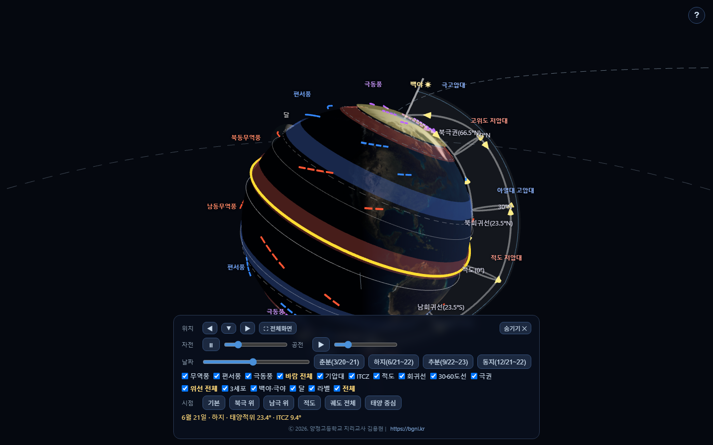

# 대기 대순환 시뮬레이터 (atmosim)

지구의 공전에 따른 계절 변화, 자전, 대기 대순환(무역풍, 편서풍, 극동풍), 백야와 극야를 한 화면의 3D로 보여 주는 수업용 시뮬레이터입니다. 지리와 지구과학 시간에 날짜를 바꿔 가며 기압대와 열적도가 어떻게 움직이는지 함께 볼 수 있습니다.

- 바로가기: https://gcs.bgnl.kr (예전 주소 https://yhk1m.github.io/atmosim/ 은 자동으로 넘어감)



## 할 수 있는 일

- **확대와 축소로 오가는 두 화면**: 멀리서 보면 공전과 절기, 가까이 보면 대기 대순환입니다. 가까워지면 이름표가 저절로 나타납니다.
- **자전과 공전**: 각각 재생, 정지, 속도 조절을 합니다. 날짜 슬라이더와 절기 단추(춘분, 하지, 추분, 동지)로 날짜를 옮깁니다.
- **바람 세 가지**: 무역풍, 편서풍, 극동풍을 따로 켜고 끕니다. 점선이 차례로 켜지며 흐름 방향을 보여 줍니다.
- **기압대**: 적도 저압대, 아열대 고압대, 고위도 저압대, 극고압대를 띠로 보여 주고, 날짜에 따라 남북으로 움직입니다.
- **열적도(ITCZ)**: 대륙 위에서는 크게, 바다 위에서는 작게 휘는 물결선으로 그립니다. 대륙은 자기 반구가 여름일 때만 열적도를 끌어당깁니다.
- **3세포 단면**: 해들리, 페렐, 극 순환 세포를 단면으로 보여 줍니다. 대기 두께는 대류권계면 모양(적도와 극의 높이 비 17 : 8)을 따릅니다.
- **위선**: 적도, 남북 회귀선, 30도와 60도선, 극권을 따로 켜고 끕니다.
- **백야와 극야, 달**: 극 지방의 낮과 밤 범위를 칠하고, 달(항성월 27.32일)의 위상이 빛에 따라 저절로 바뀝니다.
- **시점 단추**: 기본, 북극 위, 남극 위, 적도, 궤도 전체, 태양 중심.
- **리모컨**: 아래, 왼쪽, 오른쪽으로 옮기거나 숨기고(위치 기억), 전체 화면으로 봅니다. 휴대폰에서는 아래에 고정됩니다.
- **축척 안내**: 오른쪽 위 ? 단추로 실제 크기와 거리에 비해 얼마나 줄이거나 늘렸는지 봅니다.
- **단축키**: 스페이스(자전 켜고 끄기), 왼쪽과 오른쪽 화살표(하루씩), 1~4(절기로 건너뛰기).

## 수업에서 보기 좋은 장면

- 북극 위 시점에 날짜를 하지로 두면 백야를 볼 수 있습니다.
- 여름철 아시아에서는 기압대(동서 평균)와 열적도(대륙의 영향)가 어긋납니다. 일부러 그렇게 그렸습니다.

## 축척

화면은 이해를 돕기 위한 도식입니다.

| 항목 | 시뮬레이션 | 실제 |
|---|---|---|
| 달 크기 | 지구의 0.27배 | 0.27배 |
| 달 거리 | 지구 반지름의 4배 | 약 60배 |
| 태양 크기 | 지구의 2.5배 | 109배 |
| 태양 거리 | 지구 반지름의 30배 | 약 23,500배 |
| 대기 두께 | 적도에서 지구 반지름의 0.5배 | 약 17 km |
| 자전 : 공전 | 1 : 20 | 1 : 365 |

## 실행하기

빌드가 없는 정적 사이트입니다. three.js 0.160은 CDN에서 받습니다.

```bash
npx -y http-server -p 8080 -c-1                          # http://localhost:8080
node tests/astro.test.mjs && node tests/state.test.mjs   # 천문 계산과 상태 관리 테스트
```

`master`에 push 하면 GitHub Pages로 배포되고 gcs.bgnl.kr로 열립니다. 서비스 워커(`sw.js`)가 새로고침할 때마다 새 파일을 확인해서, 배포 직후에도 옛 화면이 남지 않습니다.

## 파일 구성

```
index.html          리모컨, 축척 안내 창
sw.js               서비스 워커 (늘 최신 파일 받기)
css/style.css
js/
  main.js           렌더 루프, 카메라, 모듈 조립
  state.js          상태 하나와 구독
  astro.js          천문 계산 (태양 적위, 공전 각, 열적도, 날짜)
  constants.js
  scene/            태양, 궤도, 지구, 달, 바람, 기압대, 열적도, 위선, 3세포, 백야와 극야
  ui/remote.js      리모컨
assets/earth.jpg    지구 표면 그림 (등장방형)
tests/              Node 테스트
docs/DEVLOG.md      개발 기록
docs/superpowers/   설계와 구현 계획
```

## 만든 사람

양정고등학교 지리교사 김용현  
문의: bgnlkim@gmail.com
